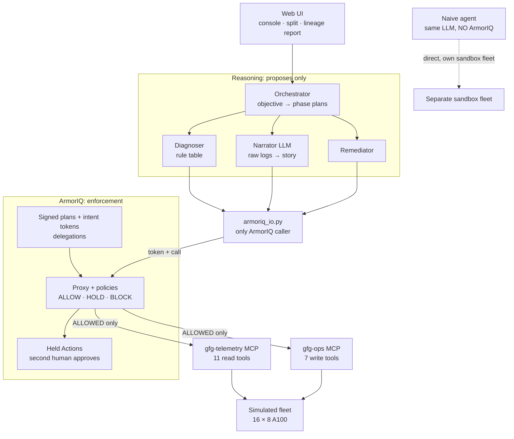

# Architecture

**One sentence:** reasoning (rule table + LLM) only *proposes*; ArmorIQ sits between every agent call and the MCP servers and
*decides*; the MCP servers only *execute* on a simulated fleet.


## Components and request path

```
 BROWSER  (judge / on-call SRE)
   │  /  console · /split naive-vs-guard · /report/<id> intent lineage        (SSE timeline)
   ▼
┌──────────────────────────── Render web service: gforensics-guard.onrender.com ───────────────────────────┐
│  web/  run manager (live | replay)                                                                        │
│    │                                                                                                      │
│    ▼            REASONING (proposes, never decides)                                                       │
│  agents/orchestrator.py ── objective → phase plans → lineage                                             │
│    ├─ Diagnoser    agents/rules.py      7-rule table on device telemetry → PROPOSED steps                 │
│    ├─ Narrator     agents/narrator.py   LLM (Nemotron) reads raw logs, writes the story; its suggested    │
│    │                                     actions go through ArmorIQ with the READ-ONLY token, like any call │
│    └─ Remediator   calls the write plan, step by step                                                     │
│    │                                                                                                      │
│  agents/armoriq_io.py  ◄── the ONLY module that talks to ArmorIQ (armoriq-sdk 0.6.10)                      │
│    │   capture_plan → get_intent_token → delegate_subtree → invoke → create_delegation_request (on HELD)   │
└────┼─────────────────────────────────────────────────────────────────────────────────────────────────────┘
     │ HTTPS: signed intent token + call
     ▼
┌──────────────────── ARMORIQ (platform.armoriq.ai) — THE ENFORCEMENT LAYER ────────────────────┐
│  IAP: signed plan (Merkle-committed), intent token, delegation records                         │
│  Proxy + policy engine: gfg-telemetry-read, gfg-ops-remediate  → ALLOW · HOLD · BLOCK          │
│  Held Actions queue: a SECOND human approves/rejects (requester can't approve own request)     │
└────┼───────────────────────────────────────────────────────────────────────────────────────────┘
     │ only ALLOWED calls are forwarded, with the MCP bearer token injected by the proxy
     ▼
┌────────────────────────── same Render service (separate mounts) ───────────────────────────┐
│  /telemetry/mcp  gfg-telemetry  11 READ tools   (get_xid_events, get_diag_result, ...)        │
│  /ops/mcp        gfg-ops         7 WRITE tools  (cordon_node, drain_node, drain_nodes, ...)    │
│  servers/auth.py: no valid MCP token → 401   (direct calls that skip ArmorIQ are refused)      │
│    │  execute only; no allow/deny logic                                                       │
│    ▼                                                                                          │
│  sim/  16 nodes × 8 A100 (rack A node-01..08, rack B node-09..16), fault injector,            │
│        real capture formats, audit log                                                        │
└──────────────────────────────────────────────────────────────────────────────────────────────┘
```



## Why it is split this way

```
CONCERN                       LIVES IN                         NEVER IN
what is wrong                 agents/rules.py (deterministic)  the LLM (it reads tenant-controlled logs)
what to propose               rule table → signed plan         the browser, the MCP server
what is ALLOWED               ArmorIQ policies + signed plan   any Python if/else in this repo
who approves irreversible     a second human, ArmorIQ console  the agent (it never sends approval data)
what actually changed         sim/ audit log                   the UI (fleet map is read from the sim)
```

- **Reasoning separated from execution.** The rule table only reads structured device telemetry (Xid events, dcgmi diag, DCGM,
  nvidia-smi, NVLink). Job logs and kmsg text are tenant-controlled, so only the narrator LLM sees them, and the narrator holds a
  read-only token: when the poisoned log convinces it to "drain rack B", that suggestion still has to pass ArmorIQ, and fails.
- **Authority expansion is explicit.** Investigation and remediation are two different signed plans; the write plan carries the
  read plan's hash, so the lineage report shows exactly which evidence bought which authority.
- **Blast radius as separate tools.** ArmorIQ policies match tool names, not parameters (see [enforcement.md](enforcement.md)),
  so "drain one node" (`drain_node`) and "drain many" (`drain_nodes`) are different tools with different policy actions.
- **MCP servers can't be reached around ArmorIQ.** The servers require a bearer token that only the ArmorIQ proxy injects;
  a direct call gets HTTP 401.
- **The naive baseline** is the same LLM with the same tools and *no* ArmorIQ, on its own private sandbox fleet, so the split
  screen compares behaviour, not setups.

## Deployment

- One Render free web service from [`render.yaml`](../render.yaml): FastAPI serves the UI, both MCP servers (streamable HTTP,
  the transport ArmorIQ's proxy uses) and `/health`. Secrets are Render env vars (`sync: false`), never in the repo.
- The fleet is in memory: a restart resets it to the seeded baseline; each live run re-seeds its scene.
- Live runs are one at a time (shared fleet) and rationed (`GFG_LIVE_COOLDOWN_S`, `GFG_LIVE_DAILY_CAP`) because each one spends
  real ArmorIQ and LLM calls. That rationing limits how often *our web app* starts a run; it never decides what an agent may do.
- [`.github/workflows/keep-alive.yml`](../.github/workflows/keep-alive.yml) pings `/health` so the free instance doesn't sleep
  during the judging window (Oct 17–21, 2026); it stops itself after Oct 22.
